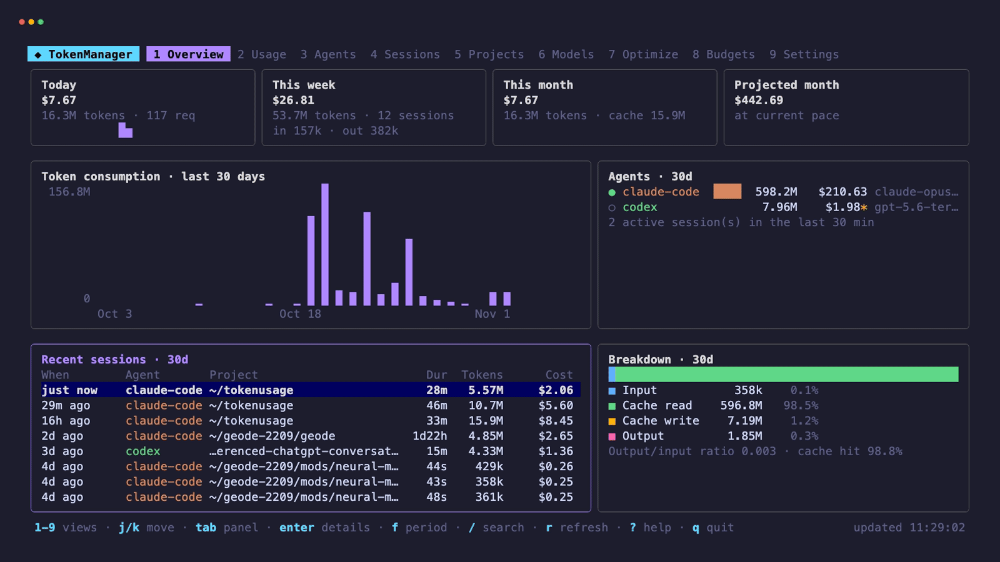

# TokenManager

A terminal-native dashboard for the tokens and money your AI coding agents spend.
It reads the session files that Claude Code, OpenAI Codex, Gemini CLI, Aider and
Continue already write to disk, normalizes them into one local SQLite database,
and shows usage, estimated cost, budgets and optimization advice. It runs in the
terminal (with an optional static HTML export), needs no account, and sends
nothing off your machine.



## Install

### Homebrew (macOS / Linux)

```bash
brew install ht2803-max/tap/tokenmanager
```

Prebuilt binaries for macOS, Linux and Windows are also on the
[releases page](https://github.com/ht2803-max/tokenmanager/releases).

### With Go

Requires Go 1.27.3 or newer. An older Go 1.21+ install downloads the newer toolchain automatically.

```bash
go install github.com/ht2803-max/tokenmanager/cmd/tokenmanager@main
```

This puts `tokenmanager` in `$(go env GOPATH)/bin` (usually `~/go/bin`). If the
command isn't found afterwards, add that directory to your `PATH`:

```bash
export PATH="$PATH:$(go env GOPATH)/bin"
```

### From source

```bash
git clone https://github.com/ht2803-max/tokenmanager.git
cd tokenmanager
make build        # binary in bin/tokenmanager
make install      # or install into $(go env GOPATH)/bin
```

`make cross` builds macOS, Linux and Windows binaries into `dist/`. SQLite is
pure Go, so no C toolchain is needed.

### Releases and Homebrew

Tagged releases are built with `goreleaser release --clean` using
`.goreleaser.yaml`, which publishes archives for each platform and a formula to
the `ht2803-max/homebrew-tap` repository.

## Quick start

```bash
tokenmanager            # interactive dashboard
tokenmanager today      # one-shot summary
tokenmanager optimize   # recommendations
tokenmanager web --open # browser dashboard (static HTML file)
```

Agents are found automatically. Each command first ingests new data
incrementally: files that haven't changed are skipped without being opened, and
appended files are read from the last byte offset. A rescan with no new data
takes a few milliseconds.

## Keyboard

| Key | Action |
|---|---|
| `1`–`9`, `←/→` | Overview, Usage, Agents, Sessions, Projects, Models, Optimize, Budgets, Settings |
| `j/k`, `↑/↓`, `pgup/pgdn`, `g/G` | move in lists |
| `tab` | switch panel (Overview), toggle the detail pane elsewhere |
| `enter` / `esc` | open / close details |
| `f` / `F` | date filter: today → week → month → 30 days → all |
| `/` | search the current list |
| `r` | rescan and refresh |
| `?` | help |
| `q` | quit |

The dashboard watches agent directories with filesystem events (fsnotify) and
updates live while you work. It also rescans slowly as a safety net.

## Commands

| Command | |
|---|---|
| `today`, `week`, `month` | totals, trend sparkline, breakdown by agent / model / project |
| `agents` | detection status, data accuracy and usage per agent |
| `sessions [-n 25]` | recent sessions with duration, context fill, cost |
| `projects`, `models` | per-project and per-model comparison |
| `costs` | cost split by input / output / cache read / cache write; month projection |
| `optimize` | 30-day analysis with estimated savings |
| `budget`, `budget set monthly 100 [--for agent:claude-code]`, `budget rm …` | budgets |
| `watch` | live stream of new requests with running cost |
| `export [-f json\|csv] [-o file]` | per-request records |
| `daemon start\|stop\|status\|run` | background collector + budget alerts |
| `scan [--rebuild]` | ingest now / rebuild the database |
| `config`, `config init`, `config path` | configuration |
| `web [-o file] [--open] [--force]` | standalone HTML dashboard ([Browser Dashboard](#browser-dashboard)) |

Global flags: `--json`, `--csv`, `--today`, `--week`, `--month`, `--all`,
`--agent`, `--project`, `--model` (substring), `--no-scan`.

## Agents and data accuracy

| Agent | Source | Tokens |
|---|---|---|
| Claude Code | `~/.claude/projects/**/*.jsonl` (also `$CLAUDE_CONFIG_DIR`) | **actual**, per API request, including 5m/1h cache writes, subagents and fast mode |
| OpenAI Codex | `~/.codex/sessions`, `~/.codex/archived_sessions` (`$CODEX_HOME`) | **actual**, from `token_count` events; cached input is split out of input |
| Gemini CLI | `~/.gemini/tmp/*/chats/*.json` | **actual** per message; projects are identified by hash |
| Aider | `.aider.chat.history.md` per project (add paths in config) | **estimated**: Aider logs rounded counts; Aider's own cost figure is used |
| Continue | `~/.continue/dev_data/**/tokensGenerated.jsonl` | **actual** prompt/generated counts, no cache data |
| Cursor | detection only | **unavailable**: Cursor keeps usage server-side |

How double counting is avoided:

- Claude Code writes one line per content block of a response, and each line
  repeats the same usage object. Records are keyed by message id + request id.
- Resumed or forked sessions copy old history into new files. Those copies
  produce the same keys and are ignored.
- Codex sometimes emits the same `token_count` event twice. Records are keyed
  by the thread's cumulative token total.
- A partial last line (a file still being written) is left for the next read.
- Truncated or rewritten files are re-read from the start; the dedup keys keep
  this idempotent.

Adding an agent means adding an `Adapter` in `internal/agents` (roots, a file
matcher, a read mode and a parser that returns `model.Record`s) and a parser in
`internal/parser` with tests.

## Costs

Costs are **estimates at public API list prices**. If you are on a
subscription (Claude Pro/Max, ChatGPT Plus/Pro), read them as the API-equivalent
value of your usage, not as your bill. Anthropic prices are built in (Claude 5
family back to Claude 3.5 Haiku), including cache read/write rates, Haiku 5.5's
long-prompt tier and fast mode. OpenAI prices are built in from OpenAI's table
(GPT-6 and GPT-5.x families back to GPT-3.5 Turbo, plus o1/o3/o4-mini),
including cached-input rates and, for models that list them, 30-minute and
12-hour cache-write rates. Codex doesn't report which cache TTL was used, so
cache writes are priced at the 30-minute rate. Models without a listed cached
or write rate bill those tokens as ordinary input. Built-in Gemini prices cover
only well-established models; please verify them.

Models are matched by exact id after removing provider prefixes and date
suffixes. A model without a known price is shown as `n/a` and its tokens are
counted as unpriced. TokenManager never borrows a price from a similar-looking
name. Add prices in `config.yaml`:

```yaml
pricing:
  my-local-model: {input: 1.25, output: 10, cache_read: 0.125}
```

## Budgets

Daily, weekly and monthly limits can be set globally or per agent, project
(path substring) or model (id substring). The CLI and TUI show progress bars
and the month-end projection. The daemon sends one desktop notification per
threshold (default 50/80/100%) per period, via macOS Notification Center or
`notify-send`. Budgets are **monitoring only**: TokenManager cannot stop an
agent or change limits set on the provider side.

## Browser Dashboard

The terminal dashboard is still the main interface. If you'd rather look at
your usage in a browser, TokenManager can also write the same data to one
standalone HTML file.

```bash
tokenmanager web                          # writes ~/.local/share/tokenmanager/dashboard.html
tokenmanager web --output ./dashboard.html
tokenmanager web --open                   # write it, then open it in the default browser
tokenmanager web --no-scan                # use the database as is, skip ingestion
```

- **Output location.** Without `--output` the file goes to
  `~/.local/share/tokenmanager/dashboard.html` (this follows `XDG_DATA_HOME`) and
  is replaced each time. If `--output` names a file that already exists, you're
  asked before it's overwritten; with no terminal attached the command stops.
  Pass `--force` to overwrite without asking. If `--output` names a directory,
  `dashboard.html` is written inside it.
- **What's inside.** Overview cards (today, week, month, projected month,
  monthly budget), daily token and spend charts, the input/output/cache mix,
  spend by agent, plus agents, sessions, projects, models, optimization
  findings and budgets. You can filter by date range (today, 7 days, 30 days,
  all time), agent, project and model, sort tables, expand sessions, hover
  over charts, and switch between dark and light themes.
- **Works offline.** The page is a single file with its CSS, JavaScript and
  data embedded. It loads nothing from the internet, starts no server, opens no
  port and sends no telemetry. A Content-Security-Policy in the file blocks
  network requests. You can double-click the file to open it.
- **Same numbers as the TUI.** Before writing the page, the command runs the
  normal incremental scan (unless you pass `--no-scan`). All totals, costs,
  budgets and findings come from the same analytics, pricing, budget and
  optimizer packages the CLI uses; the page itself only adds up and draws the
  pre-computed values. `--agent`, `--project` and `--model` limit what goes
  into the export.
- **A snapshot, not live.** The page doesn't refresh itself when new usage is
  collected. Run `tokenmanager web` again to regenerate it, then reload the
  page in your browser.
- **Treat it as private.** The file holds aggregated usage only: token counts,
  costs, model names, session IDs and project names. It never contains
  prompts, responses or code. Anyone who has the file can still read that
  data, so it's written with user-only permissions. Project paths are shown
  relative to `~`; set `privacy.hide_project_paths: true` to export only the
  last path element. The page lists at most the 1,000 most recent sessions;
  every total and chart still covers all usage.

## Daemon

`tokenmanager daemon start` runs the collector in the background
(`~/.local/share/tokenmanager/daemon.log`), so usage and alerts are captured
while the TUI is closed. To start it at login, see `packaging/launchd` (macOS)
or `packaging/systemd` (Linux).

## Optimization engine

`tokenmanager optimize` (and view 7) looks at the last 30 days and reports:

- large or repetitive instruction files (`CLAUDE.md`, `AGENTS.md`, `GEMINI.md`, …) loaded into every request
- low prompt-cache hit rates, and context being re-cached (repeated context)
- requests carrying very large contexts
- premium models used for light tasks, priced against a cheaper alternative
- unusually expensive sessions, long sessions near the context limit
- projects that dominate spend

Every saving is labelled as an estimate. Instruction files are read only to
measure them (about 4 bytes per token) and are **never modified**.

## Configuration

`~/.config/tokenmanager/config.yaml` (honors `XDG_CONFIG_HOME`; `TOKENMANAGER_CONFIG`
overrides the path). See [`config.example.yaml`](config.example.yaml): enabled
agents and path overrides, pricing, budgets, thresholds, refresh interval,
currency and conversion rate, retention, notifications and privacy. The
database is stored at `~/.local/share/tokenmanager/usage.db` (honors `XDG_DATA_HOME`).

## Privacy

Only token counts, model ids, timestamps, session ids and project paths are
stored. Prompts, responses and code are never stored. Set
`privacy.hide_project_paths: true` to keep only the last path element. The tool
makes no network requests.

## Architecture

```
cmd/tokenmanager      entry point
internal/cli          Cobra commands (text / JSON / CSV output)
internal/tui          Bubble Tea dashboard (Lip Gloss, Bubbles)
internal/agents       adapter registry and discovery
internal/parser       per-agent log parsers → model.Record
internal/collector    incremental ingestion, fsnotify watcher
internal/storage      SQLite (records, file offsets, alert state)
internal/pricing      price table and cost calculation
internal/analytics    aggregation, periods, series, projections
internal/optimizer    findings and savings estimates
internal/budget       budget evaluation
internal/daemon       background collector, notifications
internal/web          standalone HTML dashboard export (embedded assets)
internal/config       YAML configuration
internal/format       number formatting and Unicode charts
```

The usage engine (collector, storage, analytics) doesn't depend on the UI, so
every CLI command, the TUI, the daemon and the HTML export share it.

## Development

```bash
make test     # parsers, pricing, incremental collection, live watch, analytics, TUI layout
make vet
TOKENMANAGER_DUMP=1 go test ./internal/tui -run Dump -v   # print every view
TOKENMANAGER_DEBUG=1 tokenmanager scan                     # verbose ingestion log
```

The TUI tests render every view at sizes from 60×18 to 220×60 and fail if any
line overflows the terminal.

### Not implemented yet

- Usage from provider APIs (for example Anthropic's Admin usage API). All data
  currently comes from local files.
- Cursor usage. Cursor doesn't store it locally.
- Native Windows notifications (alerts are still logged), and testing on
  Windows in general.
